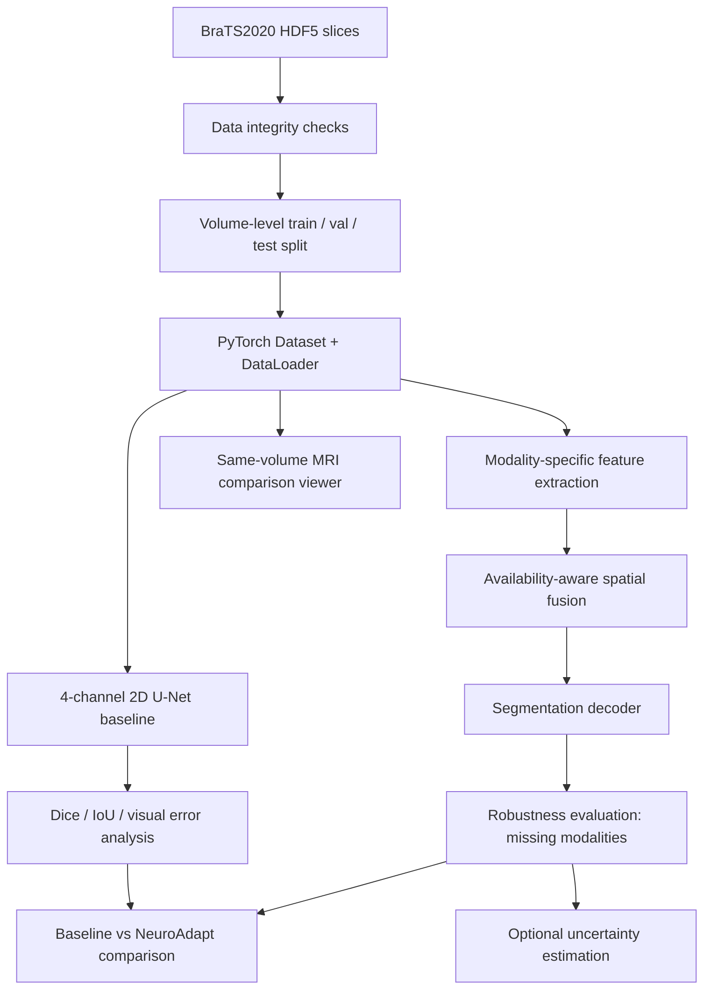

# NeuroAdapt

### Adaptive and Uncertainty-Aware Brain Tumor Segmentation Using Multimodal MRI

**Status:** Data exploration and preprocessing completed; baseline segmentation model is next.  
**Dataset:** BraTS2020 training data, preprocessed as 2D HDF5 slices.  
**Environment:** Kaggle Notebooks / PyTorch.

> **Research prototype only.** NeuroAdapt is not intended for clinical diagnosis or treatment decisions.

## 1. Overview

NeuroAdapt investigates whether **availability-aware, spatially adaptive fusion** can make brain tumor segmentation more robust when one or more MRI sequences are unavailable. The system combines four complementary MRI sequences, predicts tumor segmentation maps, and may later estimate prediction uncertainty.

**Research question:** Can adaptive multimodal fusion reduce segmentation performance degradation under missing-MRI-modality conditions compared with conventional early fusion?

### Objectives

- Build a reproducible **2D U-Net baseline** using four MRI channels.
- Learn spatially varying contributions from available MRI modalities.
- Simulate missing sequences through **modality dropout during training**.
- Evaluate segmentation accuracy and robustness under controlled missing-modality scenarios.
- Optionally produce uncertainty maps and a patient-level MRI exploration interface.

## 2. Dataset

The attached Kaggle dataset is `awsaf49/brats2020-training-data` and contains files such as:

```text
/kaggle/input/datasets/awsaf49/brats2020-training-data/
  BraTS2020_training_data/content/data/
    volume_100_slice_0.h5
    volume_100_slice_1.h5
    ...
```

Each HDF5 slice contains:

| HDF5 key | Shape | Description |
|---|---|---|
| `image` | `(240, 240, 4)` | Four MRI channels; presumed T1, T1ce, T2, FLAIR **pending dataset-card confirmation** |
| `mask` | `(240, 240, 3)` | Three segmentation channels; **exact channel semantics must be verified** |

This is a **preprocessed 2D dataset**, not the original NIfTI volume collection. Original voxel spacing and full acquisition metadata may not be available. `volume_id` is parsed from the filenames; its equivalence to a unique patient identifier must be confirmed.

## 3. Current Progress

| Stage | Status | Evidence / outcome |
|---|---|---|
| 01 — Data exploration | **Completed** | HDF5 keys, shapes, MRI visualization, mask overlays, intensity histograms, sample checks |
| 02 — Preprocessing and splitting | **Completed (initial)** | Volume-level train/validation/test split, PyTorch Dataset and DataLoader, split manifests |
| 03 — U-Net baseline | **Next** | Training, validation, per-channel Dice/IoU, prediction visualizations |
| 04 — Adaptive modality fusion | Planned | Availability masking, spatial attention, modality dropout |
| 05 — Robustness experiments | Planned | Missing-modality evaluation and ablations |
| 06 — Uncertainty + interactive demo | Optional | Uncertainty maps and patient-level visualization |

### Data exploration results

- **57,195** HDF5 slice files discovered.
- **369** distinct `volume_id` values.
- Images: **240 × 240 × 4**; masks: **240 × 240 × 3**.
- A sample of **100 slices** had consistent shapes; **42/100** contained at least one positive tumor-mask pixel. This is a *sample statistic*, not the whole-dataset tumor prevalence.
- For one inspected slice, the four image channels each had approximately zero mean and unit standard deviation, suggesting prior normalization. This does **not** establish that every slice or volume is identically normalized.
- The illustrative tumor-positive slice `volume_100_slice_100.h5` had **1,111 positive pixels in mask channel 1**, with no positives in channels 0 or 2. This does not identify channel 1 as a particular tumor region.

### Initial preprocessing and split results

| Split | Volumes | Slices |
|---|---:|---:|
| Train | 258 | 39,990 |
| Validation | 55 | 8,525 |
| Test | 56 | 8,680 |
| **Total** | **369** | **57,195** |

Splits were generated from distinct `volume_id` values (random seed `42`) rather than by randomly dividing slices. The sampled quality check inspected **150 slices** and found consistent image/mask shapes and no non-finite image values in that sample. This is not an exhaustive audit.

The PyTorch loader has been tested with a batch size of 4:

```python
{
    "image":        torch.Size([4, 4, 240, 240]),
    "mask":         torch.Size([4, 3, 240, 240]),
    "availability": torch.Size([4, 4]),
}
```

The `availability` vector is reserved for the later missing-modality experiments. The baseline uses all four channels.

## 4. Proposed Processing and Modeling Pipeline



### Proposed adaptive fusion

For each modality \(m\), an encoder extracts a feature map \(F_m(x,y)\). The fusion block predicts spatial weights \(\alpha_m(x,y)\), explicitly masking unavailable modalities before the softmax:

\[
F_{\mathrm{fused}}(x,y) = \sum_{m \in \mathcal{A}} \alpha_m(x,y) F_m(x,y),
\qquad \sum_{m \in \mathcal{A}} \alpha_m(x,y)=1,
\]

where \(\mathcal{A}\) is the set of available MRI modalities. Modality dropout will be applied **only during training** of the robust models, not the conventional baseline.

This architecture is a **proposed research direction**, not yet an implemented or validated innovation. Related adaptive/missing-modality fusion techniques exist; novelty and effectiveness require literature review and controlled ablation experiments.

## 5. Same-Patient / Same-Volume MRI Comparison

**Planned visualization feature:** choose a `volume_id` and `slice_id` to inspect all four MRI channels **side by side**, with the corresponding segmentation-mask overlays.

The viewer should support:

1. Selecting a volume and a slice from its available HDF5 files.
2. Displaying the four channels at the **same slice index and spatial location**.
3. Toggling segmentation-mask overlays and adjusting overlay opacity.
4. Comparing intensity profiles, histograms, and visible tissue contrast across sequences.
5. Scrolling through slices of the same volume to inspect how visible structures vary across anatomical position.
6. In later experiments, hiding one or more modalities and comparing segmentation outputs with the full-modality prediction.

**Interpretation:** T1, T1ce, T2, and FLAIR are different contrasts from the same examination, not consecutive time points. Differences between their appearances are **not evidence of longitudinal tumor change**. To measure tumor growth or treatment response, the system would need multiple time-stamped examinations for the *same patient*, registered and evaluated longitudinally; the current HDF5 files do not establish that capability.

### Minimal Kaggle example: compare the four MRI channels for one volume

```python
from pathlib import Path
import h5py
import matplotlib.pyplot as plt
import numpy as np

DATA_ROOT = Path('/kaggle/input')
volume_id = 100
slice_id = 100
matches = list(DATA_ROOT.rglob(f'volume_{volume_id}_slice_{slice_id}.h5'))
if not matches:
    raise FileNotFoundError('Slice not found; check volume_id and slice_id')

with h5py.File(matches[0], 'r') as f:
    image = f['image'][:]
    mask = f['mask'][:]

assert image.shape[-1] == 4 and mask.shape[-1] == 3
# Provisional names; verify the dataset channel order before scientific interpretation.
channel_names = ['MRI channel 0', 'MRI channel 1',
                 'MRI channel 2', 'MRI channel 3']
tumor_union = np.any(mask > 0, axis=-1)

fig, axes = plt.subplots(2, 4, figsize=(16, 8), constrained_layout=True)
for i in range(4):
    axes[0, i].imshow(image[..., i], cmap='gray')
    axes[0, i].set_title(channel_names[i])
    axes[1, i].imshow(image[..., i], cmap='gray')
    axes[1, i].imshow(np.ma.masked_where(~tumor_union, tumor_union),
                      cmap='autumn', alpha=0.45, vmin=0, vmax=1)
    axes[1, i].set_title(f'{channel_names[i]} + tumor overlay')
    for ax in (axes[0, i], axes[1, i]):
        ax.axis('off')
plt.show()
```

> A future Streamlit interface can expose volume/slice selection, overlay controls, modality visibility, and segmentation comparisons interactively.

## 6. Experiments and Evaluation Plan

| Experiment | Model / condition | Purpose |
|---|---|---|
| E1 | Standard 4-channel 2D U-Net | Establish baseline |
| E2 | Pretrained encoder + decoder, if feasible | Evaluate transfer learning |
| E3 | Availability-aware adaptive fusion | Test fusion mechanism |
| E4 | E3 + modality dropout | Test robustness to missing sequences |
| E5 | E4 + uncertainty estimation (optional) | Explore prediction reliability |

**Metrics:** Dice coefficient, IoU, per-region results once mask labels are confirmed, missing-modality performance drop, training/inference cost, and optionally uncertainty/error association. Compare models with the **same volume-level test partition** and controlled training settings. Report both aggregate metrics and qualitative examples, including failure cases.

## 7. Repository Layout

```text
NeuroAdapt/
├── configs/
│   ├── baseline.yaml
│   └── neuroadapt.yaml
├── data/
│   └── README.md
├── notebooks/
│   ├── 01_data_exploration.ipynb
│   ├── 02_preprocessing.ipynb
│   └── 03_experiments.ipynb
├── src/
│   ├── data/
│   │   ├── dataset.py
│   │   └── preprocessing.py
│   ├── models/
│   │   ├── encoder.py
│   │   ├── adaptive_fusion.py
│   │   ├── decoder.py
│   │   └── neuroadapt.py
│   ├── training/
│   │   ├── train.py
│   │   └── losses.py
│   └── evaluation/
│       ├── metrics.py
│       ├── evaluate.py
│       └── uncertainty.py
├── app/
│   └── streamlit_app.py
├── reports/
│   ├── figures/
│   └── results.csv
├── requirements.txt
└── README.md
```

*Some files are placeholders and planned components; the Kaggle notebooks are the currently executed work.*

## 8. Run on Kaggle

1. Create a Kaggle notebook and attach the BraTS2020 training dataset (`awsaf49/brats2020-training-data`).
2. Run `01_data_exploration.ipynb` to inspect HDF5 data and generate exploration summaries.
3. Run `02_preprocessing.ipynb` to build volume-level partitions and test the PyTorch loader.
4. Find the generated outputs at:

```text
/kaggle/working/neuroadapt_exploration/
    modality_statistics.csv
    mask_distribution.csv
    sample_checks.csv

/kaggle/working/neuroadapt_preprocessing/
    train_manifest.csv
    val_manifest.csv
    test_manifest.csv
    sample_quality_checks.csv
```

5. Save the three split manifests for reuse; subsequent notebooks must attach the same dataset and keep the same split definitions. Paths embedded in manifests are Kaggle-specific.
6. Use Kaggle GPU when training the U-Net baseline and NeuroAdapt models; GPU is unnecessary for the exploration stage.

**Suggested packages:** `numpy`, `pandas`, `h5py`, `matplotlib`, `scikit-learn`, `torch`, `tqdm`, `PyYAML`, `streamlit` (for the future viewer). Install only the dependencies required by the notebook you are running.

## 9. Validation Checklist Before Training

- [ ] Confirm MRI channel ordering from the dataset's documentation.
- [ ] Confirm the semantics, overlap, and binary encoding of the three mask channels.
- [ ] Verify that each `volume_id` corresponds to a unique patient, or otherwise derive patient-level groups.
- [ ] Inspect additional samples for anomalies and intensity consistency.
- [ ] Confirm no patient/volume overlap across splits.
- [ ] Train and evaluate the 4-input / 3-output baseline only after the label mapping is confirmed.
- [ ] Keep the test split untouched while developing models.

## 10. Next Milestone

**Step 3 — Baseline U-Net:** implement a 2D U-Net, Dice + BCE loss (conditional on confirmed binary multilabel masks), validation metrics, checkpointing, and prediction overlays. This creates the reference point for the later adaptive fusion and missing-modality experiments.

---

**NeuroAdapt** — Research and engineering project in multimodal medical image analysis. Results are preliminary until model experiments and independent evaluation are completed.
