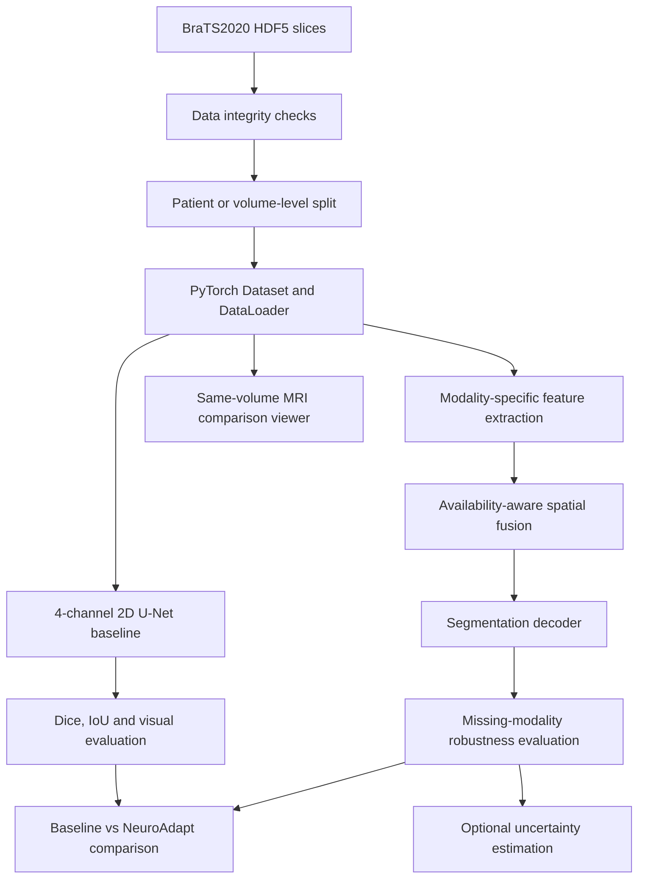

# NeuroAdapt

### Adaptive and Uncertainty-Aware Brain MRI Segmentation with Foundation Models

NeuroAdapt is a research-oriented deep learning project for multimodal brain tumor segmentation using the BraTS2020 dataset.

The project investigates adaptive fusion of MRI modalities, robustness to missing modalities, and optional uncertainty estimation.

> **Project status:** Exploratory data analysis and preprocessing are the initial development stages. Model training, adaptive fusion experiments, and uncertainty evaluation are planned. The proposed architecture has not yet been experimentally validated.

---

## 1. Project Overview

Brain tumor segmentation is an important task in medical image analysis. Magnetic Resonance Imaging (MRI) provides complementary information through multiple imaging sequences.

The BraTS2020 dataset includes four MRI modalities:

- **T1:** T1-weighted MRI.
- **T1ce:** Contrast-enhanced T1-weighted MRI.
- **T2:** T2-weighted MRI.
- **FLAIR:** Fluid-Attenuated Inversion Recovery.

Each modality highlights different anatomical structures and tissue characteristics.

NeuroAdapt aims to investigate whether adaptive spatial fusion can improve segmentation robustness, particularly when one or more MRI modalities are unavailable.

### Research objectives

1. Explore and validate the BraTS2020 HDF5 dataset.
2. Establish a reproducible 2D U-Net baseline.
3. Investigate pretrained encoders and feature extraction.
4. Implement availability-aware adaptive modality fusion.
5. Evaluate robustness under missing-modality scenarios.
6. Explore uncertainty estimation as an optional extension.
7. Develop an interactive MRI comparison and segmentation visualization interface.

---

## 2. Dataset

### BraTS2020 HDF5 Dataset

**Dataset source:** [BraTS2020 Training Data on Kaggle](https://www.kaggle.com/datasets/awsaf49/brats2020-training-data)

The current dataset is distributed as HDF5 files containing individual MRI slices.

Example:

```text
volume_100_slice_100.h5
```

Each file is expected to contain:

```python
image = f["image"][:]
mask = f["mask"][:]
```

Expected image and mask shapes:

| Component | Expected shape | Description |
|---|---|---|
| Image | `(H, W, 4)` | Four MRI channels |
| Mask | `(H, W, 3)` | Three segmentation channels |

The exact channel ordering, mask encoding, and region definitions must be verified before training or scientific interpretation.

### Data integrity checks

The exploration pipeline investigates:

- HDF5 file integrity.
- Image and mask dimensions.
- Missing or invalid values.
- MRI intensity distributions.
- Segmentation-mask distributions.
- Volume and slice identifiers.
- Potential anomalies in sample files.

### Dataset splitting

To reduce data leakage, training, validation, and testing must use disjoint patient groups.

A volume-level split is used only if each volume identifier corresponds to a unique patient. Otherwise, patient-level grouping is required.

The split manifests are saved for reuse across experiments.

---

## 3. Exploratory Data Analysis

**Notebook:** `notebooks/01_data_exploration.ipynb`

The exploratory analysis includes:

1. Dataset discovery and HDF5 inspection.
2. MRI modality visualization.
3. Segmentation-mask visualization.
4. Intensity distribution analysis.
5. Mask distribution analysis.
6. Sample integrity checks.
7. Exploratory statistics export.

### Expected outputs

```text
/kaggle/working/neuroadapt_exploration/
├── modality_statistics.csv
├── mask_distribution.csv
└── sample_checks.csv
```

These outputs help identify potential data-quality problems before model development.

---

## 4. Preprocessing

**Notebook:** `notebooks/02_preprocessing.ipynb`

The preprocessing pipeline prepares the dataset for PyTorch training.

### Main operations

- Discover valid HDF5 slices.
- Extract volume and slice identifiers.
- Construct disjoint data partitions.
- Validate image and mask shapes.
- Inspect numerical values.
- Implement PyTorch Dataset loading.
- Prepare DataLoader batches.
- Verify image-mask alignment.

### Expected outputs

```text
/kaggle/working/neuroadapt_preprocessing/
├── train_manifest.csv
├── val_manifest.csv
├── test_manifest.csv
└── sample_quality_checks.csv
```

### Important considerations

Intensity normalization must be consistent between training and evaluation.

Any normalization statistics learned from the dataset must be estimated using training data only.

Data augmentation must preserve the spatial alignment between MRI channels and segmentation masks.

The test partition must remain untouched during model development.

---

## 5. Proposed Architecture

The NeuroAdapt pipeline combines a conventional segmentation baseline with a proposed adaptive multimodal fusion architecture.

### Overall workflow



### 5.1 Baseline U-Net

The baseline model is a standard 2D U-Net receiving four MRI channels as input.

Its purpose is to establish a reproducible segmentation reference.

**Input:**

```text
[B, 4, H, W]
```

**Expected output:**

```text
[B, 3, H, W]
```

The three output channels are provisional until the dataset's segmentation-mask semantics are confirmed.

If the masks represent overlapping binary regions, the model can use sigmoid outputs with an appropriate multilabel segmentation loss.

### 5.2 Adaptive multimodal fusion

The proposed NeuroAdapt model uses modality-specific feature extraction.

For each available MRI modality, an encoder extracts a spatial feature map.

A fusion block estimates modality-specific spatial attention weights.

The fused representation is defined as:

$$
F_{\mathrm{fused}}(x,y)
=
\sum_{m \in \mathcal{A}}
\alpha_m(x,y)F_m(x,y)
$$

subject to:

$$
\sum_{m \in \mathcal{A}}\alpha_m(x,y)=1
$$

where:

- \(F_m(x,y)\) is the feature representation of modality \(m\).
- \(\alpha_m(x,y)\) is its learned spatial fusion weight.
- \(\mathcal{A}\) is the set of available modalities.

The fusion mechanism explicitly masks unavailable modalities before the softmax operation.

For modality scores \(s_m(x,y)\), a masked softmax can be expressed as:

$$
\alpha_m(x,y)
=
\frac{
a_m \exp(s_m(x,y))
}{
\sum_{j=1}^{M}a_j\exp(s_j(x,y))
}
$$

where:

$$
a_m \in \{0,1\}
$$

indicates whether modality \(m\) is available.

At least one modality must be available for the fusion operation to be defined.

### 5.3 Missing-modality robustness

The proposed robust model will be trained using modality dropout.

During training, selected MRI modalities are randomly masked to simulate incomplete acquisitions.

The conventional U-Net baseline will initially be trained without modality dropout.

The evaluation will compare segmentation performance under:

- All four modalities available.
- One modality missing.
- Multiple modalities missing.
- Selected clinically relevant modality combinations.

The aim is to measure how much segmentation performance degrades when input modalities are unavailable.

### 5.4 Optional uncertainty estimation

Uncertainty estimation may be investigated after establishing the baseline and adaptive fusion models.

Possible approaches include:

- Monte Carlo Dropout.
- Predictive entropy.
- Deep ensembles.

Uncertainty quality should be evaluated against prediction errors and, where appropriate, calibration metrics.

> **Research note:** Adaptive fusion and missing-modality segmentation are established research areas. NeuroAdapt's proposed architecture is a research direction, not a validated novel contribution. Its effectiveness and any novelty claims require literature review, ablation studies, and controlled evaluation.

---

## 6. Same-Patient / Same-Volume MRI Comparison

A planned visualization component will allow inspection of multiple MRI channels from the same volume and slice.

### Planned functionality

1. Select a volume identifier.
2. Select a slice identifier.
3. Display four MRI channels side by side.
4. Toggle segmentation-mask overlays.
5. Adjust overlay opacity.
6. Compare intensity histograms.
7. Navigate between slices.
8. Compare segmentation predictions from different models.

### Important interpretation

T1, T1ce, T2, and FLAIR represent different MRI contrasts, not consecutive time points.

Differences in appearance between modalities do not establish longitudinal tumor progression.

Longitudinal analysis would require multiple time-stamped examinations of the same patient, with appropriate image registration and evaluation.

### Minimal Kaggle visualization example

```python
from pathlib import Path

import h5py
import matplotlib.pyplot as plt
import numpy as np

DATA_ROOT = Path("/kaggle/input")

volume_id = 100
slice_id = 100

filename = f"volume_{volume_id}_slice_{slice_id}.h5"

matches = list(DATA_ROOT.rglob(filename))

if not matches:
    raise FileNotFoundError(
        f"Slice not found: {filename}"
    )

with h5py.File(matches[0], "r") as f:
    image = f["image"][:]
    mask = f["mask"][:]

assert image.ndim == 3
assert mask.ndim == 3

assert image.shape[-1] == 4
assert mask.shape[-1] == 3

assert image.shape[:2] == mask.shape[:2]

# Provisional channel names.
# Verify modality ordering from dataset documentation.

channel_names = [
    "MRI channel 0",
    "MRI channel 1",
    "MRI channel 2",
    "MRI channel 3",
]

tumor_union = np.any(mask > 0, axis=-1)

fig, axes = plt.subplots(
    2,
    4,
    figsize=(16, 8),
    constrained_layout=True
)

for i in range(4):

    axes[0, i].imshow(
        image[..., i],
        cmap="gray"
    )

    axes[0, i].set_title(
        channel_names[i]
    )

    axes[1, i].imshow(
        image[..., i],
        cmap="gray"
    )

    overlay = np.ma.masked_where(
        ~tumor_union,
        tumor_union
    )

    axes[1, i].imshow(
        overlay,
        cmap="autumn",
        alpha=0.45,
        vmin=0,
        vmax=1
    )

    axes[1, i].set_title(
        f"{channel_names[i]} + tumor overlay"
    )

    axes[0, i].axis("off")
    axes[1, i].axis("off")

plt.show()
```

A future Streamlit application may expose these visualization options through an interactive interface.

---

## 7. Experiments and Evaluation Plan

| Experiment | Model / condition | Objective |
|---|---|---|
| E1 | Standard 4-channel 2D U-Net | Establish baseline |
| E2 | Pretrained encoder + decoder | Investigate transfer learning |
| E3 | Availability-aware adaptive fusion | Evaluate fusion mechanism |
| E4 | Adaptive fusion + modality dropout | Evaluate missing-modality robustness |
| E5 | Robust fusion + uncertainty estimation | Investigate prediction reliability |

### Evaluation metrics

The main segmentation metrics are:

- Dice coefficient.
- Intersection over Union (IoU).
- Per-region segmentation performance.
- Performance degradation under missing modalities.
- Training and inference cost.
- Qualitative prediction and error analysis.

### Dice coefficient

For binary prediction \(P\) and ground-truth region \(G\):

$$
\mathrm{Dice}(P,G)
=
\frac{
2|P\cap G|
}{
|P|+|G|
}
$$

### Intersection over Union

$$
\mathrm{IoU}(P,G)
=
\frac{
|P\cap G|
}{
|P\cup G|
}
$$

Numerically stable implementations may include a small smoothing constant.

Empty-mask handling must be defined consistently for all experiments.

### Experimental controls

All models must be evaluated using:

- The same held-out test partition.
- Consistent preprocessing.
- Clearly documented training configurations.
- Reproducible random seeds.
- Consistent segmentation metrics.
- Identical missing-modality test scenarios.

Ablation studies should isolate the effects of adaptive fusion, modality dropout, and uncertainty estimation.

---

## 8. Repository Structure

```text
NeuroAdapt/
├── configs/
│   ├── baseline.yaml
│   └── neuroadapt.yaml
├── data/
│   └── README.md
├── notebooks/
│   ├── 01_data_exploration.ipynb
│   ├── 02_preprocessing.ipynb
│   └── 03_experiments.ipynb
├── src/
│   ├── data/
│   │   ├── dataset.py
│   │   └── preprocessing.py
│   ├── models/
│   │   ├── encoder.py
│   │   ├── adaptive_fusion.py
│   │   ├── decoder.py
│   │   └── neuroadapt.py
│   ├── training/
│   │   ├── train.py
│   │   └── losses.py
│   └── evaluation/
│       ├── metrics.py
│       ├── evaluate.py
│       └── uncertainty.py
├── app/
│   └── streamlit_app.py
├── reports/
│   ├── figures/
│   └── results.csv
├── requirements.txt
└── README.md
```

Some source files are placeholders for planned components. Their presence does not imply that the corresponding models or experiments have been implemented and validated.

---

## 9. Running on Kaggle

### Step 1 — Attach the dataset

Create a Kaggle notebook and attach:

[Brain Tumor Segmentation (BraTS2020)](https://www.kaggle.com/datasets/awsaf49/brats2020-training-data)

The HDF5 files should be accessible under:

```text
/kaggle/input/
```

### Step 2 — Run data exploration

Execute:

```text
notebooks/01_data_exploration.ipynb
```

Expected output directory:

```text
/kaggle/working/neuroadapt_exploration/
```

### Step 3 — Run preprocessing

Execute:

```text
notebooks/02_preprocessing.ipynb
```

Expected output directory:

```text
/kaggle/working/neuroadapt_preprocessing/
```

### Step 4 — Preserve data partitions

Save the generated manifests:

```text
train_manifest.csv
val_manifest.csv
test_manifest.csv
```

Reuse the same split definitions in subsequent experiments.

Paths stored in the manifests may be specific to the Kaggle environment.

### Step 5 — Train the baseline

Once the data and mask encoding have been validated, implement and train the baseline 2D U-Net.

GPU acceleration is recommended for model training.

Exploratory analysis does not require a GPU.

### Suggested dependencies

```text
numpy
pandas
h5py
matplotlib
scikit-learn
torch
tqdm
PyYAML
streamlit
```

Install only the dependencies required for the current development stage.

---

## 10. Validation Checklist

Before training:

- [ ] Confirm MRI channel ordering.
- [ ] Confirm segmentation-mask channel semantics.
- [ ] Verify binary and overlapping mask encoding.
- [ ] Inspect samples for numerical anomalies.
- [ ] Verify image-mask spatial alignment.
- [ ] Verify patient or volume grouping.
- [ ] Confirm no overlap across data partitions.
- [ ] Validate normalization and augmentation.
- [ ] Test PyTorch Dataset and DataLoader.
- [ ] Preserve the held-out test partition.

Before reporting model results:

- [ ] Establish baseline performance.
- [ ] Evaluate per-region segmentation metrics.
- [ ] Run missing-modality experiments.
- [ ] Perform controlled ablation studies.
- [ ] Inspect qualitative failure cases.
- [ ] Record computational costs.
- [ ] Document limitations and reproducibility settings.

---

## 11. Next Milestone

### Step 3 — Baseline U-Net

The next development milestone is to implement a reproducible 2D U-Net baseline.

Planned components:

1. Four-channel MRI input.
2. Three-channel segmentation output, subject to mask validation.
3. Dice + BCE loss for confirmed binary multilabel masks.
4. Training and validation loops.
5. Dice and IoU evaluation.
6. Model checkpointing.
7. Prediction-mask visualization.
8. Training-history tracking.

The baseline will serve as the reference for evaluating the proposed NeuroAdapt adaptive fusion architecture.

---

## 12. Project Status

| Component | Status |
|---|---|
| Dataset exploration | Initial development |
| Data preprocessing | Initial development |
| PyTorch data pipeline | Validation stage |
| Baseline U-Net | Planned |
| Adaptive fusion | Proposed |
| Missing-modality experiments | Planned |
| Uncertainty estimation | Optional |
| Interactive Streamlit viewer | Planned |
| Comparative evaluation | Planned |

---

## 13. References and Resources

- [BraTS2020 Dataset on Kaggle](https://www.kaggle.com/datasets/awsaf49/brats2020-training-data)
- [PyTorch Documentation](https://pytorch.org/docs/stable/index.html)
- [MONAI — Medical Open Network for AI](https://monai.io/)
- [Streamlit Documentation](https://docs.streamlit.io/)

Relevant literature on multimodal brain tumor segmentation, missing-modality learning, adaptive fusion, and uncertainty estimation will be added as the research progresses.

---

## 14. Disclaimer

NeuroAdapt is an academic research and engineering project.

The software and experimental models are not validated for clinical diagnosis, treatment planning, or medical decision-making.

Results should be considered preliminary until experiments and independent evaluation are completed.

---

**NeuroAdapt — Adaptive and Uncertainty-Aware Brain MRI Segmentation with Foundation Models**
